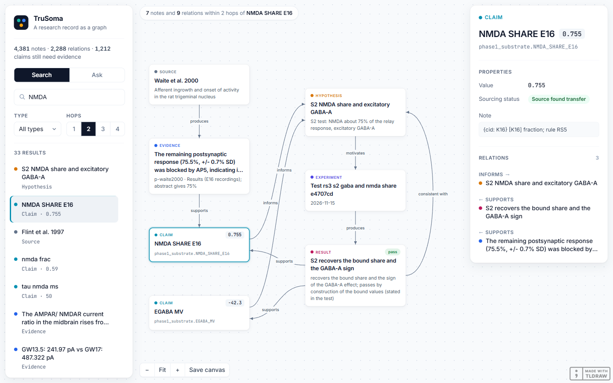

# TruSoma discourse graph

TruSoma is a simulation of the early human fetal body and its developing brain, built from published biology. The rule of the project is that every number in the model is traced to a source or recorded as a choice. This repository holds the record that does the tracing, kept as a [Discourse Graphs](https://discoursegraphs.com) vault, and the software that reads it.

**[Open the live canvas](https://kootru-repo.github.io/trusoma-discourse-graph/)** · [Project page](https://labs.kootru.com) · [Architecture](docs/architecture.md) · [Developer guide](demo/README.md)

[](https://github.com/kootru-repo/trusoma-discourse-graph/actions/workflows/ci.yaml)



## Why a discourse graph

A model of development is only as good as the numbers in it, and a number with no source is a guess. In TruSoma each value is a claim note, linked to the verbatim quote it came from, the paper that quote is in, the hypothesis it informs and the result that tested it. Every value has a recorded status, and every result is entered whatever its outcome, so the record can be questioned as well as read.

## What is here

| Part | What it does | Where |
| --- | --- | --- |
| Vault | 4,381 discourse notes and 2,288 relations: sources, verbatim quotes, claims, hypotheses, experiments and results | [`vault/`](vault) |
| Canvas | Draws any note's neighbourhood as cards and labelled relations | [`demo/apps/canvas`](demo/apps/canvas) |
| Ask | Runs questions over the graph as data ("which hypotheses have no experiment linked?"), with six presets, a question builder and a link per question, for example [`#ask=untested-hypotheses`](https://kootru-repo.github.io/trusoma-discourse-graph/#ask=untested-hypotheses) | [`demo/packages/graph/src/query.ts`](demo/packages/graph/src/query.ts) |
| MCP server | An assistant searches the graph, traces a value to its sources, lists gaps, and writes notes that a validator can refuse | [`demo/apps/mcp`](demo/apps/mcp) |
| Obsidian round trip | "Save canvas" writes a canvas file that the Discourse Graphs Obsidian plugin opens, with every card linked back to its note | [`demo/docs`](demo/docs) |
| Database load | The vault as rows for the Discourse Graphs Supabase schema | [`demo/packages/graph`](demo/packages/graph) |

## Try it

Nothing needs installing: open the [live page](https://kootru-repo.github.io/trusoma-discourse-graph/), search for a note, and widen its neighbourhood from 1 to 4 hops. The Ask tab answers questions such as which model values are backed by a quoted source.

To run everything locally (Node 22, pnpm 10.15.1, Python 3.11 or later):

```
cd demo
pnpm install
pnpm test     # unit tests on the real vault
pnpm dev      # the canvas at http://localhost:4173
pnpm start    # the MCP server over stdio
```

To connect an assistant: `claude mcp add trusoma-dg -- pnpm --dir /path/to/demo start`

## The vault is the only source

Every table, configuration file and database in the project is generated from the notes and compared byte for byte at each commit.

```
python tools/dm/check_all.py                    # validate the vault and compare every generated file
python tools/dm/test_single_source.py tamper    # change one byte of each generated file: every change is detected
```

The vault holds 1,943 value notes. 731 are linked to a verbatim quote from a paper; the others carry their status (a recorded model choice, a design value, or next in line for a source), and the Ask tab and the MCP server's `list_gaps` tool list them. Of the values that describe the fetal body, brainstem and learner, 495 of 569 are sourced (87%); the [project page](https://labs.kootru.com) keeps that count.

## Works with the Discourse Graphs plugin

The vault is written and read in Obsidian with the open-source [Discourse Graphs plugin](https://github.com/DiscourseGraphs/discourse-graph), so the software here writes that plugin's formats and adds none of its own.

- **Canvas files.** A saved canvas uses the plugin's card, relation and binding records, so it opens in Obsidian as drawn.
- **Database rows.** The load produces the rows the plugin's own conversion produces and sends them through the schema's `upsert_concepts` function as a signed-in member, under row-level security.
- **Tooling.** TypeScript in a pnpm workspace run by turbo, with tldraw, esbuild, Tailwind, vitest and zod at the versions the plugin pins, so shared record definitions behave the same in both.
- **Tested.** [CI](.github/workflows/ci.yaml) runs a [compatibility check](demo/packages/graph/scripts/check-upstream.ts) against a pinned commit of the plugin's repository on every push.

The MCP server uses the MCP SDK, and the vault's authoring tools are Python.

## Scope

- The hosted database is not open to visitors: by the schema's policies, a client that is not signed in reads no rows. The load is recorded in [`demo/docs/hosted-load.json`](demo/docs/hosted-load.json).
- The canvas is a reading view: a drawing is saved as a canvas file for Obsidian, and notes are written through the MCP server or in Obsidian.
- This repository is the record and its software; the simulation itself is developed separately.
