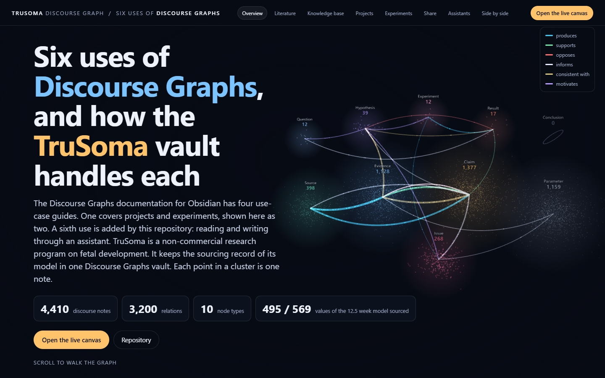
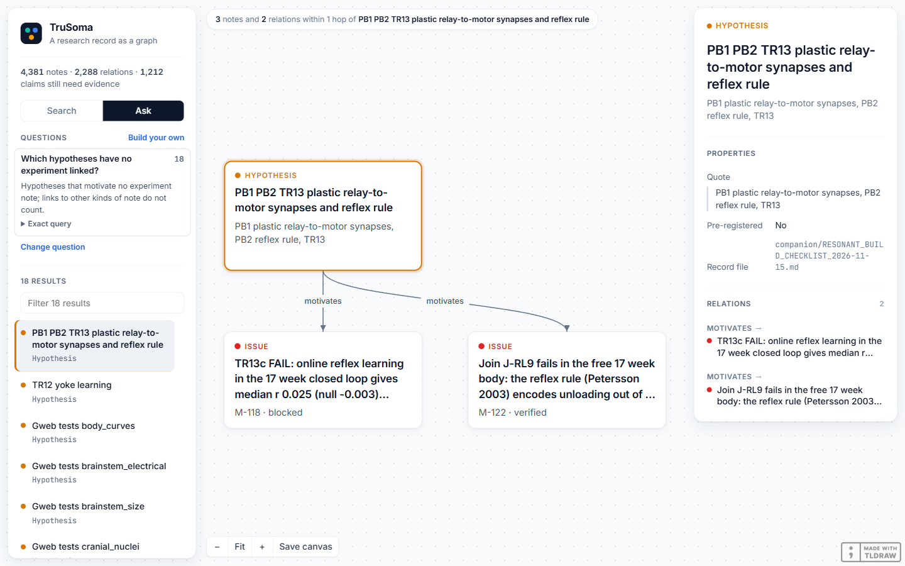

# TruSoma discourse graph

TruSoma is a simulation of the human fetal body and its developing brain at 10 to 17 weeks of gestation, built from published biology. Every number in the model is traced to a source or recorded as a choice. This repository holds that record as a [Discourse Graphs](https://discoursegraphs.com) vault of 4,410 notes and 3,200 relations, with the software that lets people and AI assistants read and write it.

**[See the six uses, illustrated](https://kootru-repo.github.io/trusoma-discourse-graph/)** · **[Open the live canvas](https://kootru-repo.github.io/trusoma-discourse-graph/explore/)** · [Project page](https://labs.kootru.com) · [Architecture](docs/architecture.md) · [Developer guide](demo/README.md)

[](https://github.com/kootru-repo/trusoma-discourse-graph/actions/workflows/ci.yaml)

[](https://kootru-repo.github.io/trusoma-discourse-graph/)

## Six ways the graph is used

The Discourse Graphs documentation for Obsidian has four use-case guides. One covers projects and experiments, shown here as two. This vault handles each on a working research project. A sixth use is added here: reading and writing through an assistant. The [illustrated page](https://kootru-repo.github.io/trusoma-discourse-graph/) walks all six through a 3D graph of the vault.

| Use | In this vault | Try it |
| --- | --- | --- |
| Synthesize the literature | 398 sources, 1,128 evidence notes and 884 `supports` relations. 714 model values are backed by a quoted source | [Sourced values](https://kootru-repo.github.io/trusoma-discourse-graph/explore/#ask=sourced-values) |
| Keep a knowledge base | The vault is the only authored source. 25 tables, configuration files and databases are generated from it and compared at every commit | [`vault/`](vault) |
| Track open work | The project's audit log is kept as 268 issue notes in the graph. 16 of them link to the 43 values they are about | [Hypotheses that await an experiment](https://kootru-repo.github.io/trusoma-discourse-graph/explore/#ask=untested-hypotheses) |
| Track experiments | 12 questions, 39 hypotheses, 12 experiments and 17 results. Each result quotes its record file and is entered whatever its reading | [Results with a positive reading](https://kootru-repo.github.io/trusoma-discourse-graph/explore/#ask=positive-results) |
| Share the work | A live canvas of any note's neighbourhood, and canvas files that open in Obsidian. Publish and import between two vaults were run on a local copy of the sync service | [Live canvas](https://kootru-repo.github.io/trusoma-discourse-graph/explore/) |
| Read and write through an assistant | An MCP server with 11 tools: 10 read or check, and 1 writes question, hypothesis, experiment and result notes. A note that misquotes its record is refused | [`demo/apps/mcp`](demo/apps/mcp) |


## Why a discourse graph

The project's rule needs a record that shows where each number came from. Each value is a claim note. It is linked to the verbatim quote it came from, the paper that quote is in, the hypothesis it informs and the result that tested it. Every value has a recorded status. Every result is entered whatever its outcome.

## What is here

| Part | What it does | Where |
| --- | --- | --- |
| Vault | 4,410 discourse notes and 3,200 relations: sources, verbatim quotes, claims, questions, hypotheses, experiments, results and issues | [`vault/`](vault) |
| Canvas | Draws any note's neighbourhood as cards and labelled relations | [`demo/apps/canvas`](demo/apps/canvas) |
| Ask | Runs questions over the graph as data ("which hypotheses have no experiment linked?"), with six presets, a question builder and a link per question, for example [`#ask=untested-hypotheses`](https://kootru-repo.github.io/trusoma-discourse-graph/explore/#ask=untested-hypotheses) | [`demo/packages/graph/src/query.ts`](demo/packages/graph/src/query.ts) |
| MCP server | An assistant searches the graph, traces a value to its sources, lists gaps, and writes notes that a validator can refuse | [`demo/apps/mcp`](demo/apps/mcp) |
| Obsidian round trip | "Save canvas" writes a canvas file that the Discourse Graphs Obsidian plugin opens, with every card linked back to its note | [`demo/docs`](demo/docs) |
| Database load | The vault as rows for the Discourse Graphs Supabase schema | [`demo/packages/graph`](demo/packages/graph) |
| Six uses, illustrated | The site's first page: the vault as a 3D graph, walked use by use. Its counts are tested against the vault | [`demo/site`](demo/site) |



## Try it

Start at the [illustrated page](https://kootru-repo.github.io/trusoma-discourse-graph/), or open the [live canvas](https://kootru-repo.github.io/trusoma-discourse-graph/explore/) (nothing to install), search for a note, and widen its neighbourhood from 1 to 4 hops. The Ask tab answers questions such as which model values are backed by a quoted source.

To run everything locally (Node 22, pnpm 10.15.1, Python 3.11 or later):

```
cd demo
pnpm install
pnpm test     # unit tests on the real vault
pnpm dev      # the canvas at http://localhost:4173
pnpm start    # the MCP server over stdio
pnpm run example   # what an assistant sees: one value traced, one write refused
```

## Ask it through an assistant

The MCP server gives an AI assistant the graph as tools. Two calls are shown here. The output below is from the real vault, shortened; `pnpm run example` prints it in full.

**Trace a value to its sources.** One call returns the whole path: the value, the verbatim quote behind it, the paper, the hypothesis it informs, the experiment and the result.

```
> trace_value { "key": "NMDA_SHARE_E16" }
{
  "claim":    { "title": "CLM - the remaining postsynaptic response (75.5%, +／- 0.7% SD) was blocked by AP5, indicating it was … (phase1_substrate.NMDA_SHARE_E16 = 0.755)", "value": 0.755, "status": "source-found-transfer" },
  "evidence": [{
    "quote":   "the remaining postsynaptic response (75.5%, +/- 0.7% SD) was blocked by AP5, indicating it was mediated by NMDA receptors ...",
    "locator": "Results (E16 recordings); abstract gives 75%",
    "sources": [{ "title": "@Waite PME, Ho SM, Henderson TA. Afferent ingrowth and onset of activity in the rat trigeminal nucleus. Eur J Neurosci … (p-waite2000)" }]
  }],
  "hypotheses": [{
    "title": "HYP- S2 NMDA share and excitatory GABA-A",
    "experiments": [{
      "title":   "EXP - test rs3 s2 gaba and nmda share e4707cd",
      "results": [{ "title": "RES - S2 recovers the bound share and the GABA-A sign", "reading": "pass" }]
    }]
  }],
  "supported": true
}
```

**Refuse a write that misquotes its record.** An assistant can add notes, but only ones that fit the grammar and quote their record file word for word. This quote is not in the file, so nothing is written:

```
> add_note { "kind": "Result", "record": "companion/TRUSOMA_PROBES.md",
             "quote": "the learner formed a perfect body map on every seed", ... }
{
  "accepted": false,
  "title": "RES - example of a refused write",
  "message": ["Result example of a refused write: its quote is not found verbatim in companion/TRUSOMA_PROBES.md"]
}
```

The server has 11 tools in all: nine for reading (search, neighbourhood, trace, gaps and the grammar), one that runs the vault's check, and `add_note`. To connect one: `claude mcp add trusoma-dg -- pnpm --dir /path/to/demo start`

## The vault is the only source

Every table, configuration file and database in the project is generated from the notes and compared byte for byte at each commit.

```
python tools/dm/check_all.py                    # validate the vault and compare every generated file
python tools/dm/test_single_source.py tamper    # change one byte of each generated file: every change is detected
```

714 model values are linked to a verbatim quote from a paper. The others carry their status (a recorded model choice, a design value, or next in line for a source), and the Ask tab and the MCP server's `list_gaps` tool list them. Of the values that describe the fetal body, brainstem and learner, 495 of 569 are sourced (87%). The [project page](https://labs.kootru.com) keeps that count.

A remark in a note is never edited after the fact. When a later reading overtakes it, the note gains a dated `later_record` beside the older words.

## Works with the Discourse Graphs plugin

The vault opens in Obsidian with the open-source [Discourse Graphs plugin](https://github.com/DiscourseGraphs/discourse-graph), which shows each note's type and relations. The software here writes that plugin's formats. What it adds is listed in the vault's schema and README: one node type (Parameter), seven relation triples, and a few note properties the plugin ignores (`dg_type`, `dg_name`, `opposes_basis`, `recordTypeId` on table rows).

- **Canvas files.** A saved canvas uses the plugin's card, relation and binding records, so it opens in Obsidian as drawn.
- **Database rows.** The load produces the rows the plugin's own conversion produces and sends them through the schema's `upsert_concepts` function as a signed-in member, under row-level security.
- **Tooling.** TypeScript in a pnpm workspace run by turbo, with tldraw, esbuild, Tailwind, vitest and zod at the versions the plugin pins, so shared record definitions behave the same in both.
- **Tested.** [CI](.github/workflows/ci.yaml) runs a [compatibility check](demo/packages/graph/scripts/check-upstream.ts) against a pinned commit of the plugin's repository on every push.

- **Publish and import.** Notes published from one vault were imported into a second vault through the plugin's sync service, run locally. Every property arrived. After a publish, `python tools/dm/restore_format.py --write` puts a note's property lines back in the form the generators read.

The MCP server uses the MCP SDK, and the vault's authoring tools are Python. The illustrated page is one static file drawn with three.js, kept outside the workspace.

## Scope

- The hosted database is not open to visitors: by the schema's policies, a client that is not signed in reads no rows. The load is recorded in [`demo/docs/hosted-load.json`](demo/docs/hosted-load.json).
- The canvas is a reading view: a drawing is saved as a canvas file for Obsidian, and notes are written through the MCP server or in Obsidian. A drawing shows up to four notes around any one note, and the side panel lists every relation.
- Publish and import were run against the sync service started locally, with the plugin built from its source. The hosted service was not part of that run.
- This repository is the record and its software; the simulation itself is developed separately.
