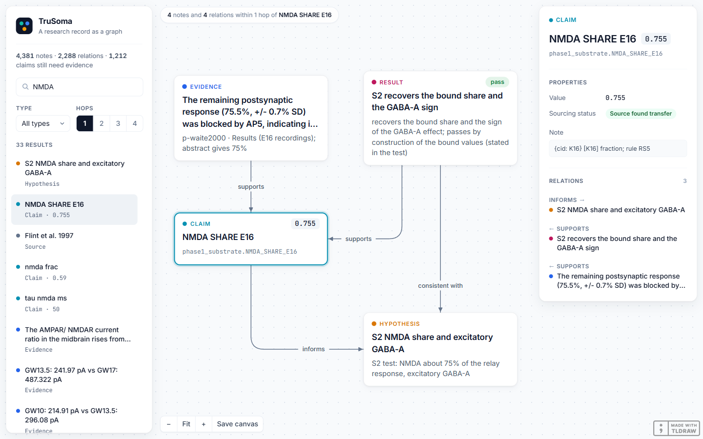

# A research record as a discourse graph that an agent can read and write

A real research project's record (4,381 notes: sources, quoted evidence, claims, hypotheses, experiments and results, failed ones included; 2,288 relations) kept in the Discourse Graphs grammar, with:

- **an MCP server** (TypeScript): an agent reads the graph and writes new notes; a write is refused unless it quotes its record file verbatim and fits the grammar;
- **a canvas** (tldraw 3.14.2): any note's neighbourhood drawn as cards and labelled arrows;
- **database rows** for the Discourse Graphs Supabase schema, loaded through its own `upsert_concepts` function into a hosted Supabase project.

In this guide "their" means the [Discourse Graphs repository](https://github.com/DiscourseGraphs/discourse-graph) and its Obsidian plugin.



```
pnpm install
pnpm test       # unit tests on the real vault (packages/graph, and the stdio test in apps/mcp), about 10 s; two of them call the vault's Python check as an independent referee
pnpm start      # stdio MCP server (its own package, apps/mcp)
```

Claude Code: `claude mcp add trusoma-dg -- pnpm --dir /path/to/demo start`

The notes are the single source: every table, configuration file and database is generated from them and compared byte for byte at each commit.

## MCP server

| tool                                                                                                               | what it does                                                                                                                                                                                                                                                    |
| ------------------------------------------------------------------------------------------------------------------ | --------------------------------------------------------------------------------------------------------------------------------------------------------------------------------------------------------------------------------------------------------------- |
| search_nodes, get_node, get_linked_nodes, get_schema, get_relationships, get_relation_types, get_node_neighborhood | read the graph; the names and argument names follow the Discourse Graphs proof-of-concept MCP server                                                                                                                                                            |
| trace_value                                                                                                        | one model value's whole path: sources and verbatim quotes behind it, the hypotheses it informs, the runs and readings that tested them (failed ones included)                                                                                                   |
| list_gaps                                                                                                          | value claims with no evidence (1,212 of 1,943 today), hypotheses no run has tested, hypotheses blocked by an open issue                                                                                                                                         |
| check                                                                                                              | the vault's commit check: validate every note, compare every generated file                                                                                                                                                                                     |
| add_note                                                                                                           | write a Question, Hypothesis, Experiment or Result note. The quote must be verbatim text of the named record file and every link must resolve to a note of the right type. A refusal returns its reasons and writes nothing. Left out when `TRUSOMA_READONLY=1` |

Writing is TypeScript only. `packages/graph/src/validate.ts` (zod) holds the rules: required properties, the quote found verbatim in its record file, the 26 allowed triples. `packages/graph/src/write.ts` writes the note file and adds the relations its links imply. A refused write leaves no trace. Two tests hold the writer to the vault's own Python tool: every probe-record note already in the vault is reproduced byte for byte from its properties, and after a write the vault's Python check (the one every commit runs) passes, generated files included.

Value notes (claims, evidence, sources) are not written by the server: they change generated configuration files and stay with the Python tool.

## Canvas (`apps/canvas`)

A tldraw 3.14.2 canvas over a static export of the vault, as a reading view: the canvas fills the window and the search and detail panels float over it. Search a note, and its neighbourhood (1 to 4 hops, 1 at the start) is drawn as cards with one labelled line per relation; a small neighbourhood is read top to bottom along its relations (what supports a note is above it, what it informs is below), a larger one in ranks by node type. A card shows a result's reading (pass, fail, no-signal). The canvas records are those of the Discourse Graphs Obsidian plugin: `discourse-node` cards with their props, `discourse-relation` shapes with tldraw's arrow props and relationTypeId, each end held by a `discourse-relation` binding, and their node migration sequence. What this view adds for drawing (the card's headline and reading, the line's routing hints) is kept in each shape's `meta`. "Save canvas" writes the drawing as their canvas file (frontmatter `tldr-dg`, the delimited JSON block, one wikilink and block reference per card).

```
cd apps/canvas
pnpm run build      # exports public/graph.json from the vault, type-checks, builds
pnpm run preview    # http://localhost:4173 (esbuild serve)
```

Checked in a browser on 2026-11-15: the start view draws 4 cards and 4 relations for the value NMDA_SHARE_E16 (its evidence, the hypothesis it informs and the result that tested it); two hops draws 7 cards and 9 relations, back to the source (`docs/canvas-nmda-share.png`). The saved file loads into a tldraw store put together as their plugin does (their shape, binding and migration definitions restated here): 8 shapes and 8 bindings for the start view. Opened in Obsidian 1.15.1 with their plugin (Discourse Graph 1.8.0) on 2026-11-15: the plugin's canvas view draws the 4 cards and 4 labelled relations with no console error, and each card's block reference resolves to its note (`docs/obsidian-canvas.png`, file `docs/Canvas - NMDA share E16.md`). Not yet: saving a rearranged canvas back, automated browser tests.

## Database rows (`packages/graph/src/dgExport.ts`, `packages/graph/scripts/load-hosted.ts`)

The vault as the rows the Discourse Graphs Postgres function `upsert_concepts` takes, following their Obsidian plugin's own conversion: 42 schema rows (9 node types, 7 relation types, 26 allowed triples), one row per note and per relation.

```
pnpm run db:hosted
```

loads them into a hosted Supabase project that holds their schema, pushed the way their deploy script does (`supabase db push`, CLI 2.122.0, 84 of 84 migrations), the way their Obsidian plugin does it: their `create-space` edge function makes the space and its account, the client signs in as that account, `create_account_in_space` gives the author, and the rows go through `upsert_concepts` under row-level security with supabase-js 2.118.0. 6,711 of 6,711 rows, no errors, unchanged on a second load, one claim read back, and a client that is not signed in reads no rows (2026-11-15, their commit 1ae4c00). No service-role key is read; a local environment file, which is not in git, holds the project address, the public key and the space password. The counts of the last load are in `docs/hosted-load.json`. Their two edge functions (`create-space`, `create-group`) are deployed from their source unchanged, with their import maps and JWT verification off as in their config; `create-group` is deployed and refuses an anonymous caller, and has not been used to make a group. The rows are compared one by one with the output of their plugin's own conversion code (`test/theirConversion.test.ts`, run when `DG_REPO` is set).

## Conformance check (`packages/graph/scripts/check-upstream.ts`)

```
DG_REPO=/path/to/discourse-graph pnpm run check:upstream
```

compares the demo with a checkout of their repository, item by item: canvas record definitions, canvas file constants, pinned package versions, package manager, workspace layout, lint, style-guide rules, formatting, row equality with their conversion, and the recorded hosted load. A dependency their repository does not have is listed as an exception, not counted as a pass. 2026-11-15: 45 of 45 pass, no exceptions, answer yes. The demo is laid out as their repository is: a pnpm 10.15.1 workspace of `apps/` (canvas, mcp) and `packages/` (graph, eslint-config) run by turbo, with their eslint preset as `@repo/eslint-config` (base.js and react-internal.js unchanged; 0 errors, 0 warnings in all packages), and the canvas built as their Obsidian plugin is (esbuild 0.17.3, the root `styles.css` through postcss with Tailwind 3.4). The MCP SDK (`@modelcontextprotocol/sdk`), which their repository does not use, is confined to `apps/mcp`; the check names it as an addition outside their stack and the answer covers the packages that mirror theirs. The CI workflow follows their ci.yaml and passes on GitHub's Linux runner.
