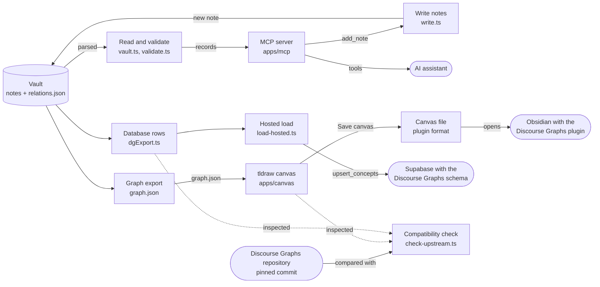

# Architecture

The vault is the only authored source. Everything else reads it or is generated from it.



Rounded boxes are software this repository does not own.

## Five paths

| Path | Steps | Proof |
| --- | --- | --- |
| An assistant asks | The MCP server parses and validates the notes, then answers a tool call: search, follow relations, or trace a value to its sources | A test starts the server over stdio, lists its tools and reads one value |
| An assistant writes | `add_note` checks the quote is verbatim text of its record file and that every link fits the grammar, then writes the note and its relations | Notes already in the vault are reproduced byte for byte; the vault's own check accepts the result |
| Canvas | The vault is exported to `graph.json`; the canvas draws a neighbourhood as the plugin's card and relation records | Record definitions compared with the plugin's source |
| Obsidian | "Save canvas" writes the plugin's canvas file format | Opened in Obsidian with the plugin: cards, relations and block references resolve |
| Database | The plugin's migrations make the schema; `create-space` makes the space; rows go through `upsert_concepts` as a signed-in member | 6,711 of 6,711 rows; rows equal the plugin's own conversion output |

## Layout

```
vault/                 the notes, the relation file, the grammar
tools/dm/              the vault's authoring and checking tools (Python)
demo/                  a pnpm workspace run by turbo
  apps/canvas          tldraw canvas, built with esbuild and Tailwind
  apps/mcp             MCP server, the only package with the MCP SDK
  packages/graph       reading, validating, writing, exporting, checking
  packages/eslint-config   the Discourse Graphs eslint preset, unchanged
```

## What the compatibility check covers

`check-upstream.ts` reads a checkout of the Discourse Graphs repository and compares, item by item: canvas shape and binding definitions, canvas file constants, pinned versions and package manager, workspace layout, the eslint preset files, lint warnings, style-guide rules, Prettier formatting, the Tailwind stylesheet head, row equality with the plugin's conversion, and the recorded hosted load. A dependency the upstream repository does not have is an exception, never a pass.
